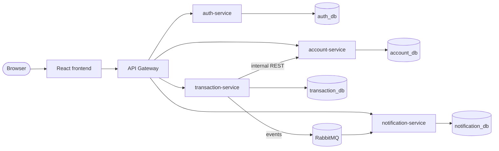

# Online Banking DevOps Platform

A production-style, **microservices-based simulated online bank** with a
complete DevSecOps delivery platform: Jenkins CI/CD, SonarQube, Trivy,
Docker, Amazon ECR, Amazon EKS, Terraform, Prometheus, Grafana and CloudWatch.

> ⚠️ **Educational portfolio project.** All accounts, balances and transfers are
> simulated. It is not connected to any real bank or payment system.

## Project status

| Phase | Status |
|---|---|
| 1 · Architecture + GitHub | ✅ In progress |
| 2 · Microservices | ⏳ Not started |
| 3 · React frontend | ⏳ |
| 4 · Database integration | ⏳ |
| 5 · Docker | ⏳ |
| 6 · Jenkins CI/CD | ⏳ |
| 7 · DevSecOps | ⏳ |
| 8 · Terraform + AWS | ⏳ |
| 9 · Kubernetes (EKS) | ⏳ |
| 10 · Monitoring + logging | ⏳ |
| 11 · Final validation | ⏳ |

## Architecture at a glance



## Documentation

| Doc | Contents |
|---|---|
| [docs/01-architecture.md](docs/01-architecture.md) | Services, communication, data ownership, transfer consistency (saga + idempotency), security model, all six architecture diagrams |
| [docs/02-tech-stack-and-setup.md](docs/02-tech-stack-and-setup.md) | Why each tool is used, required installations, local alternatives |
| [docs/03-aws-costs.md](docs/03-aws-costs.md) | AWS cost breakdown and cost-control strategy |
| [docs/04-roadmap.md](docs/04-roadmap.md) | Phase-by-phase plan and exit criteria |

## Repository structure

```
online-banking-devops-platform/
├── frontend/                 React + Vite + TypeScript UI
├── services/                 One folder per independently deployable service
│   ├── api-gateway/
│   ├── auth-service/
│   ├── account-service/
│   ├── transaction-service/
│   └── notification-service/
├── database/<service>/       SQL migrations + seeds, one folder per database owner
├── docker/                   docker-compose.yml for local development
├── jenkins/                  Jenkinsfile + shared library
├── k8s/
│   ├── base/                 namespaces, deployments, services, configmaps, ingress,
│   │                         hpa, pdb, network-policies, rbac
│   └── overlays/             dev / staging / prod (Kustomize)
├── terraform/
│   ├── bootstrap/            one-time S3 state bucket
│   ├── modules/              vpc, eks, rds, ecr, iam, secrets
│   └── environments/         dev / staging / prod root modules
├── monitoring/               prometheus rules, grafana dashboards, alerts
├── security/                 trivy config, policies
├── tests/                    cross-service integration, e2e, performance (k6)
├── scripts/                  helper scripts
└── docs/                     architecture, setup, costs, roadmap, ADRs
```

## Quick start

Local setup instructions will be added in Phase 5 (Docker Compose).

## Security

Never commit `.env` files, credentials, private keys or Terraform state. Copy
`.env.example` to `.env` for local development only.
