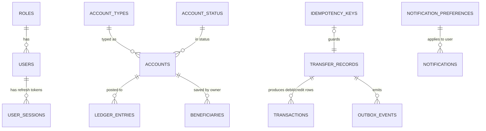
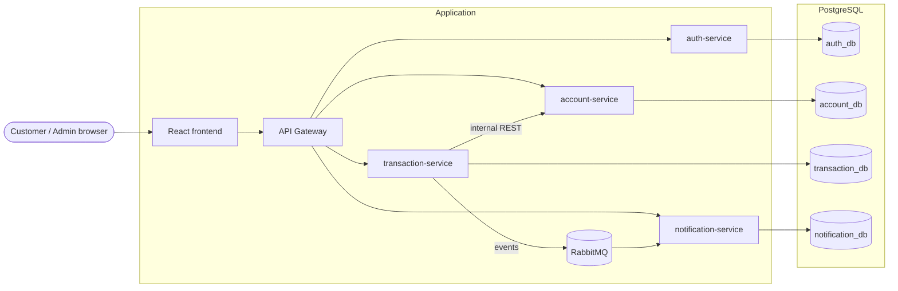
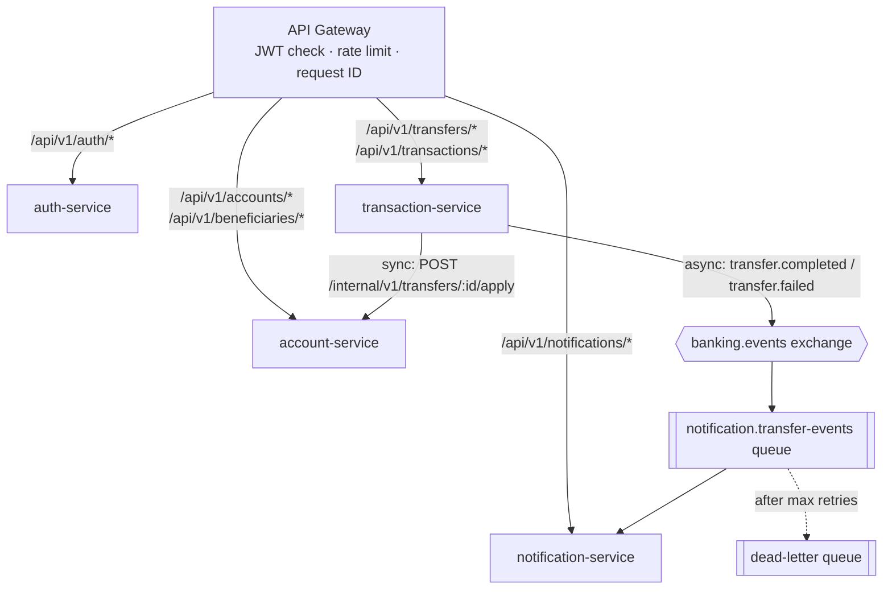
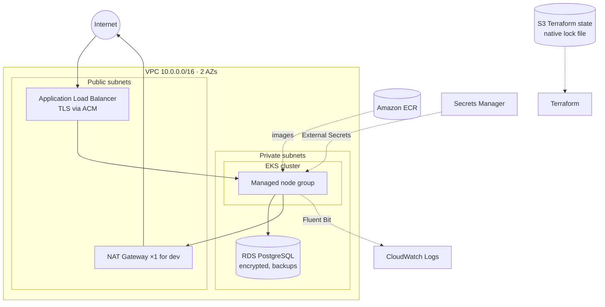
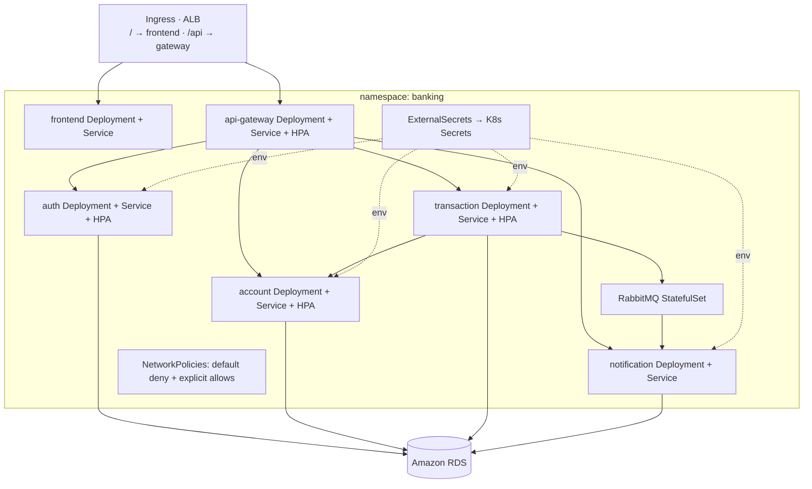
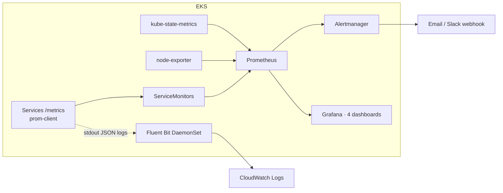

# 01 · System Architecture

> **Educational project.** All money movement is simulated. No real banking
> systems, payment networks or real notifications are involved.

## 1. What we are building

A small but realistic **digital bank** split into independently deployable
microservices. Customers can register, log in, open simulated accounts, see
balances, manage beneficiaries, transfer simulated money and receive
notifications. Administrators can see operational summaries and manage
users and accounts.

Around the application we build the full delivery platform:

```
Code → GitHub → Jenkins (test, scan, build) → Amazon ECR → Amazon EKS → Prometheus/Grafana + CloudWatch
                                     ▲
                        Terraform provisions the AWS side
```

## 2. Services and responsibilities

| Component | Port (local) | Owns data | Responsibilities |
|---|---|---|---|
| **frontend** (React + Vite) | 3000 | — | UI only. Talks **only** to the API Gateway. |
| **api-gateway** | 8080 | — | Single entry point, JWT validation, rate limiting, CORS, security headers, request IDs, request logging, routing, central error format. |
| **auth-service** | 4001 | `auth_db` | Registration, login, Argon2id password hashing, RS256 JWT access tokens, rotating refresh tokens, roles (CUSTOMER/ADMIN), profile. |
| **account-service** | 4002 | `account_db` | Accounts, account types and status, balances, beneficiaries, and the **atomic ledger posting** of transfers. |
| **transaction-service** | 4003 | `transaction_db` | Transfer API, validation, **idempotency keys**, transfer state machine, transaction history, transactional outbox → RabbitMQ. |
| **notification-service** | 4004 | `notification_db` | Consumes transfer events, stores notifications, notification preferences, mock delivery (log / local mail catcher). |
| **RabbitMQ** | 5672 / 15672 | — | Asynchronous event delivery (`banking.events` topic exchange). |
| **PostgreSQL** | 5432 | — | One server; **one database + one DB user per service**. No service can read another's database. |

### Why RabbitMQ is justified here

Notifications must **never** slow down or break a transfer. If the
notification service is down, transfers still succeed and the events wait
in a durable queue. That is real decoupling, which is exactly the use case
for a message broker. All other calls stay synchronous REST because the
caller needs the answer immediately.

## 3. How the services communicate

| From → To | Style | Example |
|---|---|---|
| Browser → Gateway | HTTPS REST (JSON) | `POST /api/v1/transfers` |
| Gateway → services | HTTP REST (cluster-internal) | proxies `/api/v1/accounts/**` → account-service |
| transaction-service → account-service | HTTP REST on `/internal/v1/**` + internal service token | apply a transfer posting |
| transaction-service → notification-service | **Async event** via RabbitMQ | `transfer.completed`, `transfer.failed` |
| Every service → its own DB | PostgreSQL driver (`pg`) | — |

Rules:

1. `/internal/**` routes are **never** routed by the gateway. They are protected
   by an internal token now and by Kubernetes NetworkPolicies later.
2. Every service verifies the JWT itself using the **public** key (defence in
   depth). Only auth-service holds the private signing key.
3. A correlation ID (`X-Request-Id`) is generated at the gateway and passed
   to every downstream call and event, so one request can be traced across
   all logs.
4. Services do not share code at runtime or share databases. Cross-service
   references (for example `accounts.user_id`) are plain UUIDs, not foreign keys.

### Public API (via gateway, all under `/api/v1`)

| Method & path | Service | Role |
|---|---|---|
| `POST /auth/register`, `POST /auth/login`, `POST /auth/refresh`, `POST /auth/logout` | auth | public |
| `GET/PATCH /auth/me` | auth | any logged in |
| `GET /admin/users`, `PATCH /admin/users/:id/status` | auth | ADMIN |
| `GET /accounts`, `POST /accounts`, `GET /accounts/:id` | account | owner |
| `GET/POST/DELETE /beneficiaries` | account | owner |
| `GET /admin/accounts`, `PATCH /admin/accounts/:id/status` | account | ADMIN |
| `POST /transfers` (header `Idempotency-Key`), `GET /transfers/:id` | transaction | owner |
| `GET /transactions?accountId=` | transaction | owner |
| `GET /admin/transactions/summary` | transaction | ADMIN |
| `GET /notifications`, `PATCH /notifications/:id/read`, `GET/PUT /notifications/preferences` | notification | owner |

Every service also exposes `GET /health/live`, `GET /health/ready` and `GET /metrics`.

## 4. Database ownership



| Database | Tables (required + additions) |
|---|---|
| `auth_db` | `users`, `roles`, `user_sessions` |
| `account_db` | `accounts`, `account_types`, `account_status`, **+ `ledger_entries`** (immutable money log, unique per transfer), **+ `beneficiaries`** |
| `transaction_db` | `transfer_records` (one row per transfer + state), `transactions` (history rows per account: DEBIT/CREDIT), `idempotency_keys`, **+ `outbox_events`** |
| `notification_db` | `notifications`, `notification_preferences`, **+ `processed_events`** (consumer de-duplication) |

**Money is stored as `BIGINT` minor units** (cents): `$12.34` is stored as `1234`, with a
3-letter `currency` column. There is never any floating point arithmetic.
`CHECK (balance_minor >= 0)` is enforced by the database itself.

## 5. Safe simulated transfers: the consistency design

### The problem

Balances live in **account-service** and transfer records live in
**transaction-service**. These are two databases, so a single SQL
transaction cannot cover both.

### The solution: orchestrated saga with one atomic "pivot" step

All money movement (debit and credit) happens in **one local ACID
transaction inside account-service**. transaction-service orchestrates the
saga around that step. Because the debit and credit can never be split, no
compensating "refund" is ever needed for balances. Compensation only
involves marking the transfer `FAILED`.

```mermaid
sequenceDiagram
  autonumber
  participant UI as React UI
  participant GW as API Gateway
  participant TX as transaction-service
  participant TXDB as transaction_db
  participant AC as account-service
  participant ACDB as account_db
  participant MQ as RabbitMQ
  participant NS as notification-service

  UI->>GW: POST /api/v1/transfers + Idempotency-Key + JWT
  GW->>GW: verify JWT, rate limit, add X-Request-Id
  GW->>TX: forward
  TX->>TXDB: BEGIN; INSERT idempotency_key (user, key, request_hash)
  alt key already exists
    TXDB-->>TX: conflict
    TX-->>UI: same stored response (or 409 in progress / 422 different body)
  end
  TX->>TXDB: INSERT transfer_record (status=PENDING); COMMIT
  TX->>AC: POST /internal/v1/transfers/{transferId}/apply
  AC->>ACDB: BEGIN
  AC->>ACDB: SELECT ... FOR UPDATE both accounts (ordered by id → no deadlock)
  AC->>AC: check owner = caller, both ACTIVE, same currency, from ≠ to, balance ≥ amount
  AC->>ACDB: UPDATE balances; INSERT ledger_entries (UNIQUE transfer_id)
  AC->>ACDB: COMMIT
  AC-->>TX: APPLIED (or REJECTED + reason)
  TX->>TXDB: BEGIN; transfer→COMPLETED/FAILED; INSERT transactions rows; store response on idempotency_key; INSERT outbox_event; COMMIT
  TX-->>UI: 201 Created / 422 with reason
  TX->>MQ: outbox relay publishes transfer.completed / transfer.failed
  MQ->>NS: deliver (at-least-once)
  NS->>NS: skip if event_id already processed, else store notification
```

### How each requirement is met

| Requirement | Mechanism |
|---|---|
| 1–2. Verify sender and receiver accounts | account-service checks that both exist and are `ACTIVE` while holding row locks |
| 3. Ownership and authorization | account-service checks `from.user_id = initiatedBy` itself (it owns the data and never trusts the caller); the gateway and transaction-service also check the JWT |
| 4. Sufficient balance | checked under `SELECT … FOR UPDATE`, plus `CHECK (balance_minor >= 0)` as a final safety net |
| 5. No duplicate processing | (a) client `Idempotency-Key` stored with a `UNIQUE (user_id, key)` constraint; (b) `UNIQUE (transfer_id)` on `ledger_entries`, so the apply step is idempotent too |
| 6. Atomic debit and credit | a single PostgreSQL transaction in account-service |
| 7. Record the transaction | `transfer_records` + `transactions` + immutable `ledger_entries` |
| 8. No partial balances on failure | any error causes a `ROLLBACK`, so both balances stay unchanged |

### Failure scenarios

| What fails | Result | Recovery |
|---|---|---|
| Validation fails (insufficient funds and similar) | account-service rolls back and returns `REJECTED` | transfer becomes `FAILED`, user notified |
| account-service unreachable before apply | transfer stays `PENDING` | a reconciler job retries `apply` (safe because it is idempotent on `transferId`) or marks it `FAILED` after N attempts |
| Timeout **after** account-service committed | transfer stays `PENDING` | the reconciler calls `GET /internal/v1/transfers/{id}`, sees it was applied and marks it `COMPLETED`. Money is never moved twice |
| Client retries the same request | same `Idempotency-Key` | stored response is returned, no second debit |
| RabbitMQ down | event stays in `outbox_events` | relay retries; the transfer itself is unaffected |
| Event delivered twice | — | notification-service de-duplicates through `processed_events` |

## 6. Security model (summary)

- **Passwords:** Argon2id. **Access token:** RS256 JWT, 15 min. **Refresh token:**
  random 256-bit value in an `HttpOnly; Secure; SameSite=Strict` cookie, stored
  only as a SHA-256 hash in `user_sessions`, rotated on every use and fully
  revoked if an old token is reused.
- **RBAC:** `CUSTOMER` and `ADMIN` roles in the JWT, enforced by middleware in each service.
- **Input validation:** `zod` schemas on every endpoint. Parameterised SQL only.
- **Headers/CORS/rate limits:** `helmet`, strict CORS allow-list, `express-rate-limit`
  (stricter limit on `/auth/login`).
- **Logging:** `pino` with redaction of `password`, `authorization`, `cookie`,
  tokens and account numbers. Audit log events for login, transfer, and admin actions.
- **Errors:** clients get a generic message + request ID. Stack traces are never sent.
- **Platform:** non-root containers, private RDS, TLS at the ALB, Secrets Manager,
  NetworkPolicies, least-privilege IAM (EKS Pod Identity), image scanning gate.

## 7. Diagrams

### 7.1 Overall system architecture



### 7.2 Microservices communication



### 7.3 CI/CD pipeline

```mermaid
flowchart LR
  dev[Developer push / PR] --> gh[GitHub] -->|webhook| j[Jenkins]
  j --> chg[Detect changed services]
  chg --> inst[Install deps] --> lint[Lint] --> ut[Unit tests] --> it[Integration tests]
  it --> sq[SonarQube analysis] --> qg{Quality gate}
  qg -- fail --> stop1[[Stop]]
  qg -- pass --> sec[Secret scan + dependency audit + Trivy fs/config]
  sec --> build[Docker build<br/>tag = git SHA] --> trivy{Trivy image scan}
  trivy -- CRITICAL --> stop2[[Stop]]
  trivy -- pass --> ecr[Push to ECR] --> eks[Deploy to EKS<br/>kustomize image tag]
  eks --> roll{rollout status}
  roll -- fail --> undo[kubectl rollout undo]
  roll -- ok --> smoke[Smoke tests] --> rep[Publish reports]
```



### 7.4 AWS infrastructure



### 7.5 Kubernetes deployment



### 7.6 Monitoring and observability


